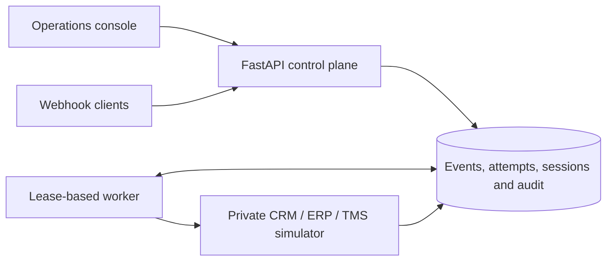

# SyncOps

**Integration monitoring and recovery for a self-hosted operations lab.**

SyncOps tracks synthetic CRM, ERP and TMS synchronization jobs. Operators can see what failed, follow retry history using a correlation ID and replay a dead-letter event after resolving its cause. The lab uses local services and has no paid runtime dependency.

## What you can demonstrate

- Create or configure an integration and submit a synthetic event through the browser or the REST API.
- Monitor real queued, successful, retrying and dead-letter events in the operations console.
- Simulate a temporary outage or a rate limit and inspect retry attempts and scheduling.
- Investigate permanent failure, authorize a replay and verify the result and audit history.
- Confirm ingress idempotency and understand how the simulator deduplicates a repeated delivery.

## Start on Windows

Use PowerShell 7.4+, Python 3.12 and Node.js 24 with npm. The launcher checks for the bundled Codex Python when the Windows Store alias is the only Python on PATH. Pass `-PythonPath` to select a Python 3.12 installation explicitly.

```powershell
pwsh -File scripts/Start-SyncOps.ps1
```

Open [SyncOps on port 5173](http://127.0.0.1:5173/). Sign in as `admin`, `operator` or `viewer` with the corresponding locally generated value in `.syncops/credentials.json`. The launcher does not print those values. It applies Alembic migrations and starts the API, worker, mock service and web app on loopback. Press Ctrl+C in the launcher to stop. On later runs use `-SkipInstall` when dependencies are already installed.

The native SQLite database and local logs are stored in the ignored `.syncops/` directory. Preserve that directory to retain history and credentials.

## Start the Compose profile

The Compose profile uses PostgreSQL and a frontend reverse proxy. It requires a Docker Engine with current Compose and BuildKit support, plus PowerShell 7.4+ for the settings generator. Initialize new local secrets once.

```powershell
pwsh -File scripts/Initialize-Compose.ps1
docker compose up -d --build --wait
```

Open [SyncOps on port 8080](http://127.0.0.1:8080/) and use the admin password from your local `.env`. The application, database and mock are on a private Compose network. Stop services with `docker compose down` and keep the named database volume. See [project status](PROJECT_STATUS.md) for current profile verification and Kubernetes lab progress.

## Architecture



The API stores an event and its queue state before acknowledging ingestion. A worker claims due work, records an attempt and sends the event to a fixed mock adapter. A response can be lost after an effect commits. Delivery is at least once when retries or lease recovery occur. The mock adapter deduplicates the effect using the stable event ID. See [architecture decisions](docs/adr/0001-core-architecture.md) and the [trust boundary](docs/adr/0002-simulator-trust-boundary.md).

## API and configuration

- [API contract](docs/api-contract.md) documents authenticated endpoints, list filters, simulation and replay.
- Native interactive API docs are served at [port 8000](http://127.0.0.1:8000/docs). The Vite and Compose frontend proxies route `/api/` internally.
- The optional `SYNCOPS_WEBHOOK_SECRET` enables authenticated webhook intake. Use a dedicated synthetic installation secret. Set processing policies on each integration and the mock service origin via trusted deployment configuration.
- Viewers can inspect data, operators can run simulations and replay, and admins can change integrations and inspect full audit history. Keep local credential files private. Destination URLs and auth secrets belong to deployment configuration.

## Verify and operate

```powershell
Push-Location backend
& ..\.venv\Scripts\python.exe -m pip install -r requirements-dev.txt
& ..\.venv\Scripts\python.exe -m ruff check .
& ..\.venv\Scripts\python.exe -m pytest -q
Pop-Location
npm --prefix frontend run build
& .\.venv\Scripts\python.exe scripts/smoke.py --base-url http://127.0.0.1:5173 --credentials .syncops/credentials.json
```

GitHub CI checks Python and TypeScript and runs the Compose smoke path. Native worker logs include event and correlation IDs, while the dashboard shows database and worker state. The API exposes an internal Prometheus-format `/metrics` endpoint. See [recovery runbook](docs/runbooks/recovery.md) for a failed-event walkthrough and safe native SQLite snapshots.

If the native launcher exits, inspect `.syncops/logs/`. Ports 5173, 8000 and 8001 must be free for the local profile. If the UI loads but the delivery is pending, check the worker state and the newest attempt. If sign-in fails after editing local credentials, restore the initialization credentials for the existing database. Local accounts are created on initialization.

## Project records

- [Portfolio walkthrough](docs/portfolio.md) and [verification evidence](docs/verification.md)
- [Engineering workflow](docs/engineering-workflow.md)
- [Specification](PROJECT_SPEC.md), [status](PROJECT_STATUS.md), [roadmap](ROADMAP.md) and [changelog](CHANGELOG.md)
- [MIT license](LICENSE)
