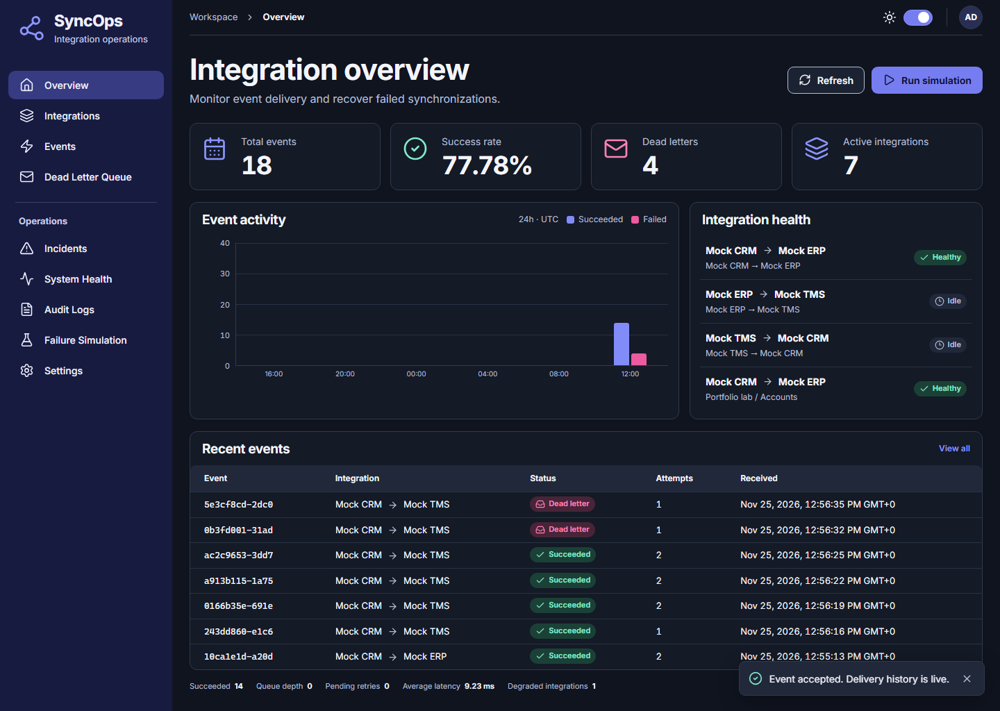
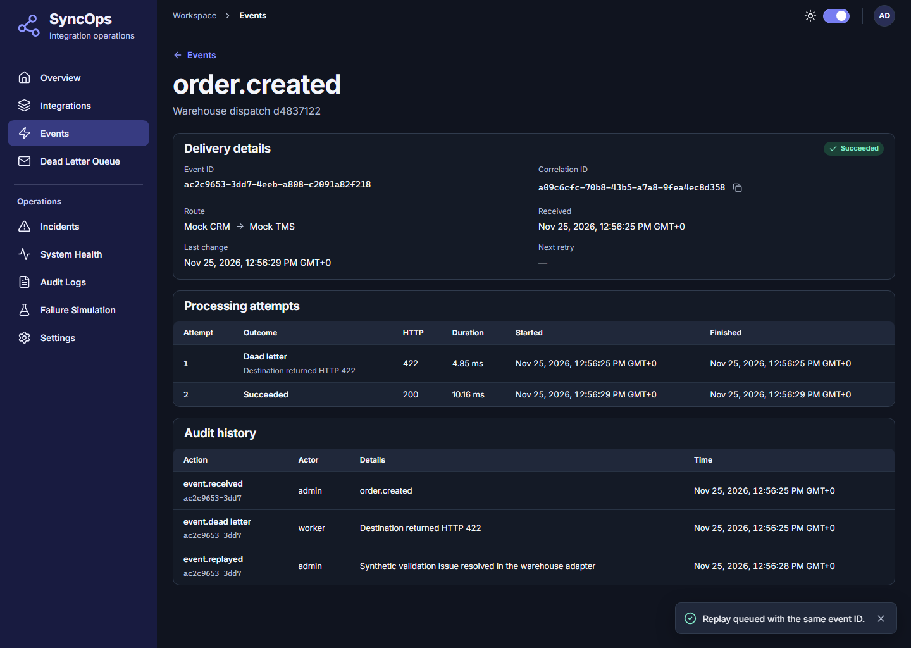
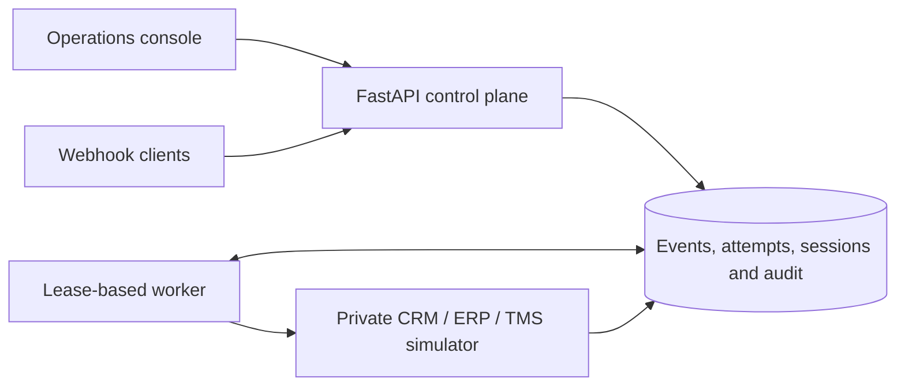
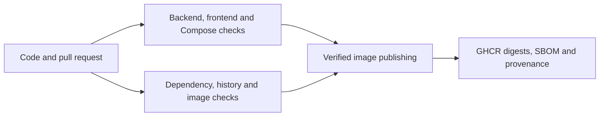
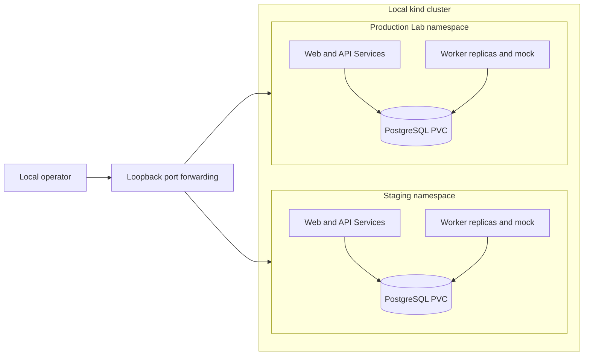
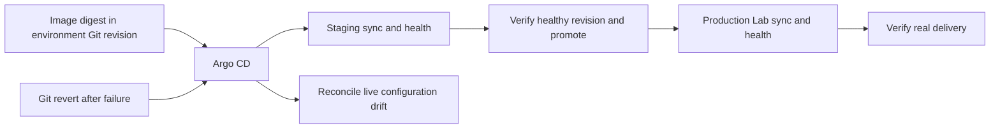
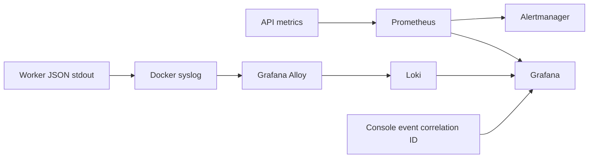
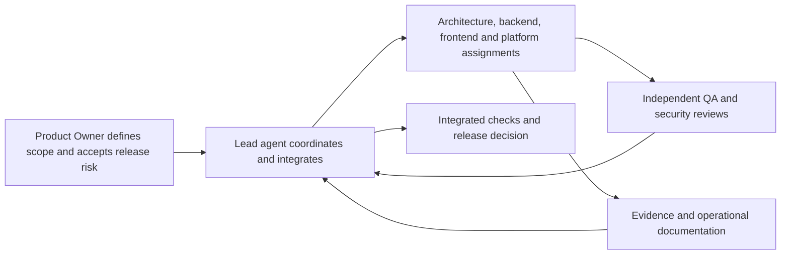

# SyncOps

[](https://github.com/kyoukoq/syncops/actions/workflows/ci.yml) [](https://github.com/kyoukoq/syncops/actions/workflows/supply-chain.yml)

**A self-hosted integration reliability platform and DevOps engineering lab.**

[SyncOps v0.2.0](https://github.com/kyoukoq/syncops/releases/tag/v0.2.0) is the stable Advanced DevOps Lab release. The Git tag identifies the tested application commit. Both GHCR `v0.2.0` tags resolve to the approved, tested image digests. [Release decision and exact image references](docs/releases/v0.2.0.md)

When a logistics order update fails between a CRM, ERP and transport system, an operator needs to know what happened, whether the system will retry and how to recover without creating a duplicate. SyncOps makes that delivery lifecycle visible. It records synthetic events and attempts, ties investigation to stable correlation IDs and audits authorized recovery. The lab uses local services with synthetic data.

## What you can demonstrate

- Create or configure an integration and submit a synthetic event through the browser or the REST API.
- Monitor real queued, successful, retrying and dead-letter events in the operations console.
- Simulate a temporary outage or a rate limit and inspect retry attempts and scheduling.
- Investigate permanent failure, authorize a replay and verify the result and audit history.
- Confirm ingress idempotency and understand how the simulator deduplicates a repeated delivery.

## Local application screenshots

Windows Chromium captured these screens against the local WSL2 PostgreSQL deployment with synthetic data.





## Start on Windows

Use PowerShell 7.4+, Python 3.12 and Node.js 24 with npm. The launcher checks for the bundled Codex Python when the Windows Store alias is the only Python on PATH. Pass `-PythonPath` to select a Python 3.12 installation explicitly.

```powershell
pwsh -File scripts/Start-SyncOps.ps1
```

Open [SyncOps on port 5173](http://127.0.0.1:5173/). Sign in as `admin`, `operator` or `viewer` with the corresponding locally generated value in `.syncops/credentials.json`. The launcher does not print those values. It applies Alembic migrations and starts the API, worker, mock service and web app on loopback. Press Ctrl+C in the launcher to stop. On later runs use `-SkipInstall` when dependencies are already installed.

The native SQLite database and local logs are stored in the ignored `.syncops/` directory. Preserve that directory to retain history and credentials.

## Start the Compose profile

The Compose profile uses PostgreSQL and a frontend reverse proxy. It requires Docker Engine 28.0+, the Docker Compose plugin and BuildKit. Open Ubuntu WSL2 and keep the terminal open while using the lab.

```bash
systemctl --user start docker
docker context use rootless
cd ~/SyncOps
bash scripts/syncops.sh start compose
bash scripts/syncops.sh urls compose
```

Open [SyncOps on port 8080](http://127.0.0.1:8080/) from Windows and use the admin password from the Ubuntu checkout's private `.env`. The database and mock stay on private Compose networks. Stop services with `bash scripts/syncops.sh stop compose`. The named volumes retain the data. See the [operator guide](docs/runbooks/local-operations.md) for backup, restore drills, demo batches and the Kubernetes profile.

Use `bash scripts/syncops.sh start logs` for the full observability profile. Verified Windows loopback endpoints include [Grafana](http://127.0.0.1:3000/), [Prometheus](http://127.0.0.1:9090/) and [Alertmanager](http://127.0.0.1:9093/). Use a separate Grafana credential. Loki and Alloy collect worker logs without exposing their HTTP APIs to Windows. [Observability runbook](docs/runbooks/observability.md)

The verified scope is a single Windows and WSL2 host, trusted local users, synthetic data, and loopback-only access. Live HTTPS Ingress was not run. Visual acceptance of the native Windows SQLite console remains unverified. [Workstation acceptance](docs/local-acceptance.md) · [Accepted residual risks](docs/security-risk-register.md)

## Architecture



The API stores an event and its queue state before acknowledging ingestion. A worker claims due work, records an attempt and sends the event to a fixed mock adapter. A response can be lost after an effect commits. Delivery is at least once when retries or lease recovery occur. The mock adapter deduplicates the effect using the stable event ID. See [architecture decisions](docs/adr/0001-core-architecture.md) and the [trust boundary](docs/adr/0002-simulator-trust-boundary.md).

### Delivery pipeline



### Kubernetes lab



### GitOps promotion and recovery



### Observability



### Engineering ownership



React and TypeScript provide the operator console. FastAPI, SQLAlchemy and Alembic implement the API, worker and schema lifecycle on SQLite or PostgreSQL. Docker Compose, kind and Helm host the lab profiles. The repository separates image publishing and attestations from GitOps deployment verification. Follow the [technical guide](docs/technical-guide.md), [presentation walkthrough](docs/portfolio-presentation.md) and [acceptance evidence](docs/verification.md) for the implementation, tested revisions and limits.

## API and configuration

- [API contract](docs/api-contract.md) documents authenticated endpoints, list filters, simulation and replay.
- Native interactive API docs are served at [port 8000](http://127.0.0.1:8000/docs). The Vite and Compose frontend proxies route `/api/` internally.
- The optional `SYNCOPS_WEBHOOK_SECRET` enables authenticated webhook intake. Use a dedicated synthetic installation secret. Set processing policies on each integration and the mock service origin via trusted deployment configuration.
- Viewers can inspect data, operators can run simulations and replay, and admins can change integrations and inspect full audit history. Keep local credential files private. Destination URLs and auth secrets belong to deployment configuration.

## Verify and operate

```powershell
Push-Location backend
& ..\.venv\Scripts\python.exe -m pip install -r requirements-dev.txt
& ..\.venv\Scripts\python.exe -m ruff check .
& ..\.venv\Scripts\python.exe -m pytest -q
Pop-Location
npm --prefix frontend run build
& .\.venv\Scripts\python.exe scripts/smoke.py --base-url http://127.0.0.1:5173 --credentials .syncops/credentials.json
```

GitHub CI checks Python and TypeScript and runs the Compose smoke path. Native worker logs include event and correlation IDs, while the dashboard shows database and worker state. The API exposes an internal Prometheus-format `/metrics` endpoint. See [recovery runbook](docs/runbooks/recovery.md) for a failed-event walkthrough and safe native SQLite snapshots.

If the native launcher exits, inspect `.syncops/logs/`. Ports 5173, 8000 and 8001 must be free for the local profile. If the UI loads but the delivery is pending, check the worker state and the newest attempt. If sign-in fails after editing local credentials, restore the initialization credentials for the existing database. Local accounts are created on initialization.

## Advanced DevOps Lab

- [Windows container host activation](docs/runbooks/windows-container-host.md)
- [Helm deployment and Kubernetes lab](deploy/kubernetes/README.md)
- [Argo CD promotion and rollback lab](deploy/gitops/README.md)
- [Central worker log investigation](docs/runbooks/trace-worker-incident.md)
- [PostgreSQL recovery and reliability drill](ops/postgres_reliability/README.md)
- [Container supply chain](docs/supply-chain.md)
- [Security risk register](docs/security-risk-register.md)
- [Portfolio lifecycle walkthrough](docs/advanced-lab-demo.md)

## Project records

- [Portfolio walkthrough](docs/portfolio.md) and [verification evidence](docs/verification.md)
- [Engineering workflow](docs/engineering-workflow.md)
- [Specification](PROJECT_SPEC.md), [status](PROJECT_STATUS.md), [roadmap](ROADMAP.md) and [changelog](CHANGELOG.md)
- [MIT license](LICENSE)
