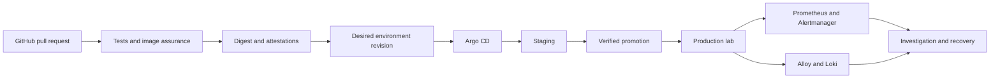

# Advanced DevOps Lab demonstration

Use one disposable environment and synthetic operations. Follow the evidence for each link in the lifecycle before presenting it as verified.

| Step | Demonstration and evidence |
| --- | --- |
| Code change and pull request | Open the container assurance PR and inspect the replacement of the vulnerable runtime base. [PR #7](https://github.com/kyoukoq/syncops/pull/7) |
| CI and security | Show Compose and Chromium regression checks, redacted history scanning, non-root image checks, Trivy output and CycloneDX generation. The latest frontend scan found zero high or critical findings. The backend reported 53 findings with no fixes in the scan database. [Container assurance](https://github.com/kyoukoq/syncops/actions/runs/45511484050) |
| Container image | Show the verified GHCR candidate digest and its provenance and SBOM attestations. Both candidates support anonymous manifest access. [Candidate publication](https://github.com/kyoukoq/syncops/actions/runs/45512578781) |
| GitOps deployment | Use a verified staging revision, immutable image digests and controlled production-lab promotion when the Argo CD gate is available. |
| Monitoring and incident | Submit a temporary outage in Failure Simulation. Copy the correlation ID, show the worker retry and recovery in Loki and compare the application record and Prometheus dashboard. [Hosted log trace](https://github.com/kyoukoq/syncops/actions/runs/45511230280) |
| Recovery and measurements | Run the isolated PostgreSQL drill. Compare the pre-backup data with the restored fingerprints, observe the effect of one lost post-backup write, and demonstrate a healthy new delivery. [Recovery drill](https://github.com/kyoukoq/syncops/actions/runs/45511422619) |



The diagram shows the target lifecycle. The status record distinguishes hosted evidence from Windows and release gates. [Project status](../PROJECT_STATUS.md)

## Seed the native demo

From the repository root on Windows, run the seed script against your existing native profile. It creates three dedicated synthetic routes and uses stable idempotency keys for nine delivery scenarios.

```powershell
& .\.venv\Scripts\python.exe scripts/seed_demo.py --credentials .syncops/credentials.json
```

The real events include recovered temporary outages, a 429 retry and two permanent validation failures in the DLQ. The script reports their correlation IDs so the operator can locate the attempts or replay one event from the console.
